# Previsão de Churn na Comunidade TMW
### Case Prático em Python e Databricks (CPPD) - ([ASN.ROCKS](https://asn.rocks/))

Projeto de Data Science de ponta a ponta desenvolvido no **Case Prático em Python e Databricks**, com dados reais da comunidade [Téo Me Why](https://teomewhy.org/twitch), uma iniciativa de educação gratuita em dados que faz lives na Twitch.

O projeto cobre todas as etapas de um pipeline de dados: entendimento do negócio, criação de features em SQL, montagem da ABT, modelagem com MLflow e uma proposta de ação de retenção.


---

## Problema de negócio

| Etapa | Objetivo |
|---|---|
| **Modelo** | Prever a probabilidade de churn de cada usuário nos próximos 28 dias |
| **Priorização** | Listar os 50 clientes com a maior probabilidade de churn |
| **Ação** | Propor uma ação de retenção para esses clientes |

---

## Dados

O projeto combina duas fontes da comunidade TMW:


**TMW Loyalty System** (`workspace.tmw_loyalty`) · [dataset no Kaggle](https://www.kaggle.com/datasets/teocalvo/teomewhy-loyalty-system/): o sistema de pontos da comunidade na Twitch. Os usuários acumulam pontos ao interagir nas lives: mensagens no chat, lista de presença (`!presente`), sequências de dias consecutivos (*streaks*) e resgate de pôneis.

| Tabela | Conteúdo |
|---|---|
| `transacoes` | Cada transação de pontos de um cliente (data, quantidade de pontos) |
| `transacao_produto` | Liga cada transação ao produto que a gerou |
| `produtos` | Tipos de interação (ChatMessage, Lista de presença, Presença Streak, Resgatar Ponei etc.) |

**TMW Education Platform** (`workspace.tmw_education`) · [dataset no Kaggle](https://www.kaggle.com/datasets/teocalvo/teomewhy-education-platform): a plataforma de cursos. Como o usuário pode conectar a conta da Twitch à plataforma, é possível relacionar o engajamento nas lives com o consumo de cursos.

| Tabela | Conteúdo |
|---|---|
| `usuarios_tmw` | Liga o usuário da plataforma ao cliente da Twitch |
| `cursos_episodios_completos` | Episódios concluídos por usuário |
| `cursos_episodios` | Catálogo de episódios de cada curso |

---

## Arquitetura do pipeline

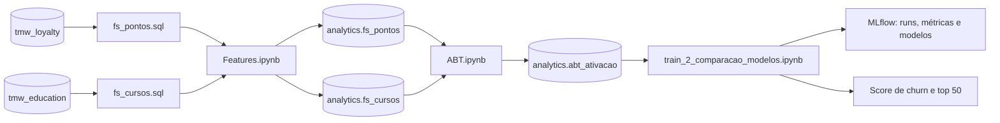

1. **Feature store:** as consultas `fs_pontos.sql` e `fs_cursos.sql` recebem uma data de referência (`{date}`) e calculam as features de cada cliente usando só o que aconteceu **antes** dessa data. O `Features.ipynb` executa as consultas para cada safra mensal e grava em tabelas Delta, sobrescrevendo apenas a partição da `dtRef` (`replaceWhere`). Assim, cada safra pode ser reprocessada sem afetar as demais.
2. **ABT:** o `ABT.ipynb` junta as duas feature stores, calcula a variável resposta e monta a amostra de modelagem em `workspace.analytics.abt_ativacao`.
3. **Modelagem:** o notebook de treino segue o SEMMA, compara quatro algoritmos e registra tudo no MLflow.

---

## Variável resposta

- **Público:** clientes com pelo menos uma transação nos 28 dias anteriores à `dtRef`.
- **`flAtivacao = 1`:** o cliente volta a transacionar nos 28 dias a partir da `dtRef`.
- **Churn:** `flAtivacao = 0`. A probabilidade de churn é `1 − prob_ativacao`.
- **Safras:** mensais.

**Amostragem da ABT:**
- **Treino e teste:** safras até `2026-05-01`, com **uma safra sorteada por cliente**, para que nenhum cliente apareça mais de uma vez.
- **OOT (*out-of-time*):** todos os clientes da safra `2026-06-01`, usada para simular a aplicação do modelo num período futuro.

| Base | Registros | Origem | Taxa de resposta |
|---|---|---|---|
| Treino | 1.723 | 80% da base | 27,05% |
| Teste | 431 | 20% da base | 27,15% |
| OOT | 239 | Última safra | **56,07%** |

> Na OOT, a taxa de resposta é cerca do dobro da observada em treino e teste.

---

## Features

**Pontos (`fs_pontos`):** comportamento nos últimos 28 dias e ao longo da vida do cliente.

| Grupo | Exemplos |
|---|---|
| Frequência e recência | `qtFrequencia` (dias distintos com transação em 28 dias), `recencia`, `freqVida`, `diasPrimeiraTransacao` |
| Volume | `QtdeTransacoes`, `qtPontos`, `qtPontosPositivos`, `saldoDia` |
| Ranking | `zScore` (pontos do cliente padronizados em relação aos demais) |
| Mix de produtos | `pctTransacaoChatMessage`, `pctTransacaoListapresenca`, `pctTransacaoPresencaStreak`, `qtdeProdutoDistintos` |
| Streak | `flStreak`, `DiasUltimoStreak` |

**Cursos (`fs_cursos`):** `qtdCursosIniciados`, `qtdCursosFinalizados`, percentual de avanço em cada curso, tempo médio entre o primeiro e o último episódio (`avgTempoInicioUltimo`) e tempo médio para concluir um curso (`avgTempoInicioFim`).

---

## Modelagem (SEMMA)

| Etapa | O que foi feito |
|---|---|
| **Sample** | Split treino/teste 80/20 estratificado pelo target e base OOT separada |
| **Explore** | Nulos, médias por classe, variáveis quase constantes (21 de 51), IV/KS/AUC univariados e correlação de Spearman |
| **Modify** | Imputação (0 para cursos, máximo para tempos e streak), aprendida só no treino; seleção de 11 features por IV médio/forte e filtro de correlação (\|ρ\| ≥ 0,8) |
| **Model** | `GridSearchCV` com 5 folds estratificados e ROC AUC: Random Forest, XGBoost, CatBoost e LightGBM (114 combinações) |
| **Assess** | AUC em treino, teste e OOT; refit em treino + teste; feature importance; lift por faixa de score |

Todos os experimentos são rastreados no **MLflow**: parâmetros, métricas, gráficos e o modelo final de cada algoritmo.

### Modify: imputação de variáveis

1. **Diagnóstico:** identificar a proporção de nulos e definir uma estratégia de imputação.
2. **Tratamento:** imputar as variáveis para não restarem nulos.

| Estratégia | Regra | Variáveis |
|---|---|---|
| `0` | Imputar 0 | Cursos (`qtdCursos*` e avanço por curso) |
| `máx` | Imputar o máximo observado daquela coluna | `DiasUltimoStreak`, `avgTempoInicioUltimo`, `avgTempoInicioFim` |

> 🔒 Valores de imputação calculados somente na base de treino.

### Explore: exploração de dados

**Taxa por variável:** `taxa = média com target 1 ÷ média com target 0`

| Maiores taxas: mais presentes em quem ativa | Taxas zeradas ou indefinidas |
|---|---|
| 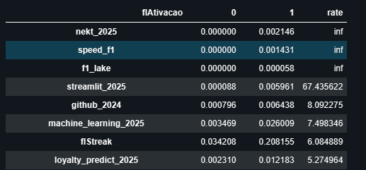 | 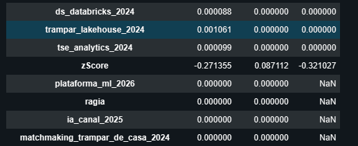 |

`inf`: média zero entre quem não ativa · `NaN`: zero nos dois grupos. A exploração usa somente a base de treino.

**Variáveis quase constantes: 21 de 51.** Praticamente um único valor em toda a base, o que dá pouca informação para separar quem ativa de quem não ativa.

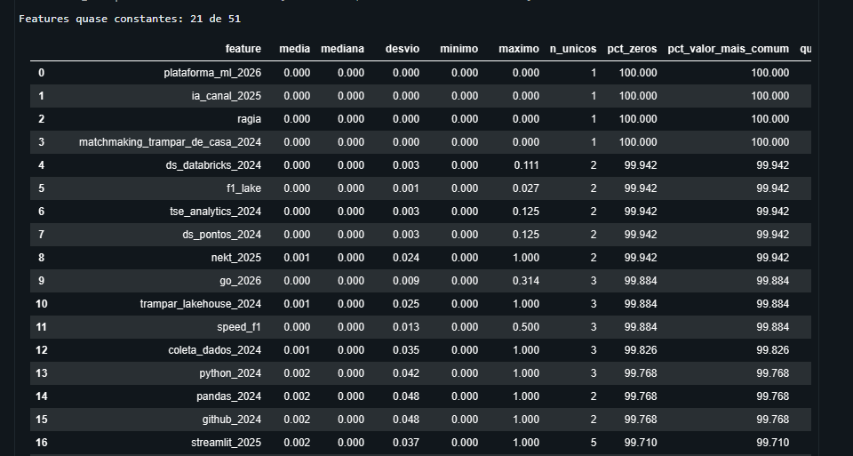

**Information Value (IV)**

| Faixa | IV |
|---|---|
| Forte | IV ≥ 0,3 |
| Médio | 0,1 ≤ IV < 0,3 |
| Fraco | 0,02 ≤ IV < 0,1 |

`qtFrequencia` lidera com IV ≈ 1,0, seguida de `freqVida` e `saldoDia`. São 11 variáveis com IV forte e 2 com IV médio.

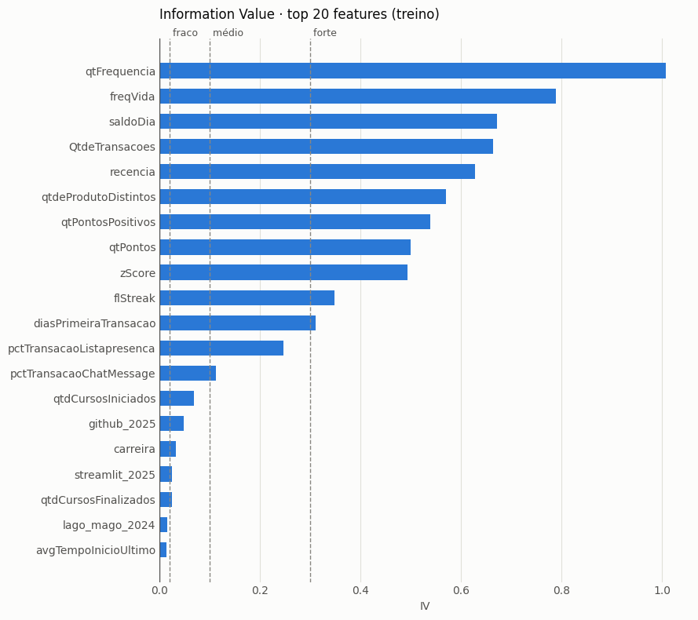

**Correlação entre variáveis:** 12 pares com \|correlação de Spearman\| ≥ 0,8.

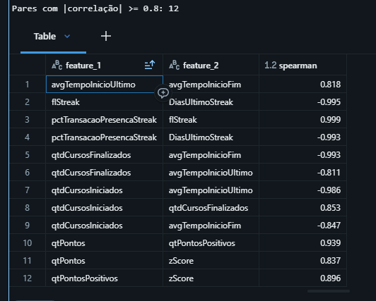

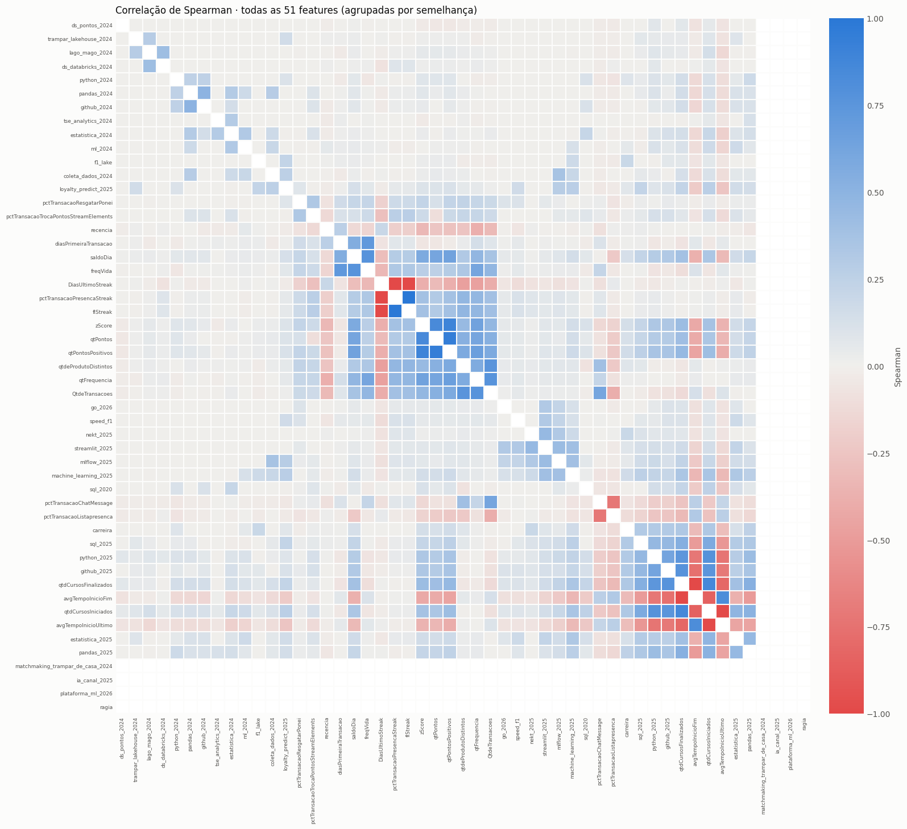

### Modify: seleção de variáveis

**51** variáveis na base → **13** com IV forte ou médio → **11** após o filtro de correlação

- **Information Value:** selecionadas as variáveis com IV forte e médio.
- **Correlação de Spearman:** removidas as acima de \|0,8\|, mantida a de maior IV.

**Variáveis selecionadas (11):** `qtFrequencia`, `freqVida`, `saldoDia`, `QtdeTransacoes`, `recencia`, `qtdeProdutoDistintos`, `qtPontosPositivos`, `flStreak`, `diasPrimeiraTransacao`, `pctTransacaoListapresenca`, `pctTransacaoChatMessage`.

### Model: algoritmos e grid de hiperparâmetros

`GridSearchCV` · Métrica: ROC AUC · 5 folds estratificados · `refit = True` · 114 combinações

| Algoritmo | Combinações | Grid | Fixos |
|---|---|---|---|
| Random Forest | 36 | `min_samples_leaf`: 10 · 100 · 200<br>`max_features`: sqrt · 0.3 · 0.5<br>`max_depth`: None · 12<br>`max_samples`: 0.7 · None | `n_estimators` 500 |
| XGBoost | 36 | `learning_rate`: 0.03 · 0.1<br>`max_depth`: 3 · 5 · 7<br>`min_child_weight`: 1 · 10 · 30<br>`reg_lambda`: 1 · 10 | `n_estimators` 300 · `subsample` 0.8 · `colsample_bytree` 0.8 · `hist` |
| CatBoost | 18 | `learning_rate`: 0.03 · 0.1<br>`depth`: 4 · 6 · 8<br>`l2_leaf_reg`: 1 · 3 · 10 | `iterations` 500 · `eval_metric` AUC |
| LightGBM | 24 | `learning_rate`: 0.03 · 0.1<br>`num_leaves`: 15 · 31<br>`min_child_samples`: 20 · 100 · 300<br>`reg_lambda`: 0 · 10 | `n_estimators` 300 · `subsample` 0.8 · `colsample_bytree` 0.8 |

<details>
<summary>Código completo dos algoritmos e grids</summary>

```python
modelos = {

    "random_forest": (
        ensemble.RandomForestClassifier(n_estimators=500, random_state=42, n_jobs=-1),
        {
            "classificador__min_samples_leaf": [10, 100, 200],   # folhas maiores = menos overfitting
            "classificador__max_features": ["sqrt", 0.3, 0.5],
            "classificador__max_depth": [None, 12],
            "classificador__max_samples": [0.7, None],                   # cada árvore vê 70% ou 100% das linhas
        },
    ),

    "xgboost": (
        xgboost.XGBClassifier(subsample=0.8, colsample_bytree=0.8, tree_method="hist",
                              eval_metric="auc", random_state=42, n_jobs=-1),
        {
            "classificador__n_estimators": [300],
            "classificador__learning_rate": [0.03, 0.1],
            "classificador__max_depth": [3, 5, 7],
            "classificador__min_child_weight": [1, 10, 30],              # peso mínimo por folha
            "classificador__reg_lambda": [1, 10],                        # L2
        },
    ),

    "catboost": (
        catboost.CatBoostClassifier(eval_metric="AUC", random_seed=42, verbose=0, allow_writing_files=False),
        {
            "classificador__iterations": [500],
            "classificador__learning_rate": [0.03, 0.1],
            "classificador__depth": [4, 6, 8],
            "classificador__l2_leaf_reg": [1, 3, 10],                    # L2 (o padrão é 3)
        },
    ),

    "lightgbm": (
        # subsample_freq=1 É OBRIGATÓRIO: sem ele o LightGBM ignora o subsample
        lightgbm.LGBMClassifier(subsample=0.8, subsample_freq=1, colsample_bytree=0.8,
                                random_state=42, n_jobs=-1, verbose=-1),
        {
            "classificador__n_estimators": [300],
            "classificador__learning_rate": [0.03, 0.1],
            "classificador__num_leaves": [15, 31],
            "classificador__min_child_samples": [20, 100, 300],          # principal freio contra overfitting
            "classificador__reg_lambda": [0.0, 10.0],                    # L2
        },
    ),
}

grid = model_selection.GridSearchCV(estimator=model_pipeline,
                                    param_grid=param_grid,
                                    scoring="roc_auc",
                                    cv=cv,
                                    refit=True,
                                    n_jobs=1,
                                    verbose=1)
```

</details>

---

## Resultados

| Algoritmo | AUC treino | AUC teste | AUC OOT | AUC OOT (refit) | Gap treino − teste |
|---|---|---|---|---|---|
| **Random Forest** | 0,877 | 0,788 | **0,857** | **0,852** | 0,089 |
| LightGBM | 0,826 | 0,788 | 0,849 | 0,843 | **0,037** |
| XGBoost | 0,839 | 0,790 | 0,854 | 0,841 | 0,049 |
| CatBoost | 0,878 | **0,794** | 0,844 | 0,830 | 0,084 |

- **Random Forest:** melhor AUC no OOT, 0,857, ou 0,852 com refit.
- **LightGBM:** menor gap treino − teste (0,037), o menos sobreajustado.
- **CatBoost:** maior AUC no teste (0,794), mas a menor no OOT com refit (0,830).

> No teste, os quatro ficam a menos de 0,007 entre si; no OOT com refit, a diferença chega a 0,023.

**Modelo escolhido: Random Forest**, pela maior AUC no OOT. As variáveis mais importantes são `qtFrequencia` (18,8%), `recencia` (16,7%) e `freqVida` (14,8%).

**Variáveis mais importantes:** cerca de 19% da importância total do Random Forest vem de `qtFrequencia`.

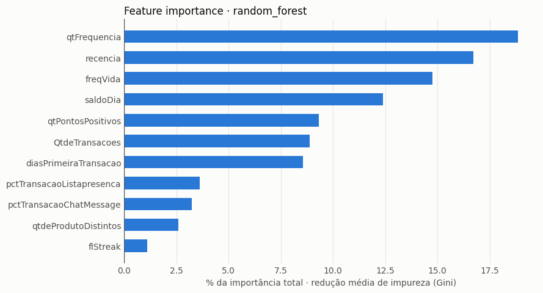

<details>
<summary>Feature importance dos outros algoritmos (XGBoost, LightGBM e CatBoost)</summary>

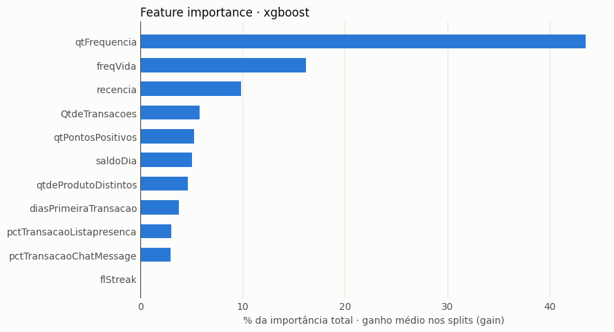

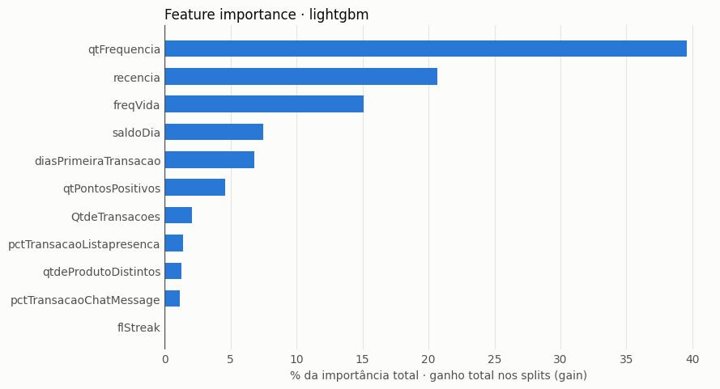

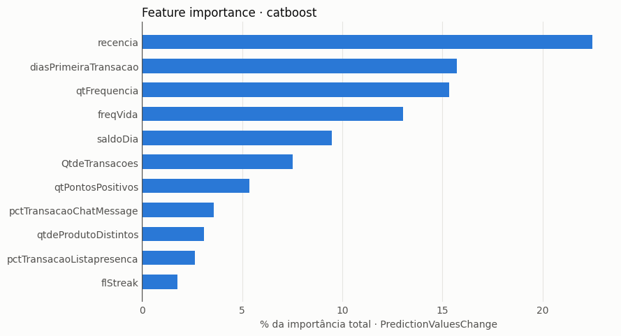

</details>

**Lift de churn na base OOT** (239 clientes, taxa média de churn de 43,9%):
- **77%** de churn nos 20% de maior risco, contra **0%** nos 20% de menor risco
- **69%** dos churns concentrados nos 40% de maior risco
- Lift de **1,8×** na faixa de maior risco, para um máximo possível de 2,3×

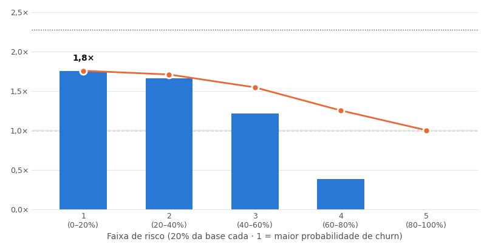

*Barras: lift da faixa · linha laranja: lift acumulado · linha pontilhada superior: lift máximo possível (2,3×) · linha tracejada: modelo aleatório (1,0×). Random Forest · base OOT (dtRef 2026-06-01) · 239 clientes.*

**Clientes prováveis para churn:** os 50 clientes com a maior probabilidade de churn estimada pelo modelo, com `prob_churn` entre 81,8% e 99,0%.

<details>
<summary>Lista dos 50 clientes</summary>

| # | IdCliente | prob_churn |
|---|---|---|
| 1 | `a1db280b-8560-4f65-8fb0-77df5cb7edc1` | 99,0% |
| 2 | `d67e9bfb-6ec6-443c-93f0-9632e095b6ea` | 96,3% |
| 3 | `fd663d42-5d89-446c-85dd-fbdc021765a7` | 96,1% |
| 4 | `4fa284fb-8588-429d-8fe5-01ac867f5158` | 95,1% |
| 5 | `ca765ed2-30eb-4a5a-bb45-a5d467396e08` | 94,7% |
| 6 | `dc0f534d-364b-427b-9959-03c93d11fb21` | 94,2% |
| 7 | `4cd2358e-ecc5-42c8-bee3-3273b75cf0ce` | 93,6% |
| 8 | `aafb7ea2-76bb-4bae-b895-9ba77937a9a8` | 93,5% |
| 9 | `ee66216e-5ab0-4af2-baf3-500597421388` | 93,2% |
| 10 | `119b90af-acae-4d54-ae75-9f45e246e34f` | 92,7% |
| 11 | `028d6ac0-a347-49b3-923f-8cac66926c31` | 92,5% |
| 12 | `6fdd59b2-1102-430f-8e90-3a691f26bfa2` | 92,2% |
| 13 | `c0cc5117-649c-4e00-ae18-e160cc9040e0` | 92,2% |
| 14 | `bc027356-4343-40d0-934f-b8697a6e848e` | 92,0% |
| 15 | `bbe410ff-5061-41f5-8440-1850589f2e01` | 91,7% |
| 16 | `e58e35dd-aa78-412a-904a-95f1413a9df5` | 91,3% |
| 17 | `99c7eff2-e238-434d-91ed-b76adf229b83` | 91,2% |
| 18 | `bd98ecd6-23b0-4f15-917d-4b39ff890aa6` | 90,9% |
| 19 | `0b592dd4-6347-435a-9df0-56f8cbca8f34` | 90,7% |
| 20 | `31244830-6109-44e0-aa16-82f3379fbe21` | 90,1% |
| 21 | `e6c5a6c7-2fc9-4fb9-8431-3b3fb2961108` | 89,8% |
| 22 | `b3125691-9323-4b57-bdf2-88668c4ba373` | 89,8% |
| 23 | `549cd57d-2372-46cb-8c28-8634c6e4538b` | 89,6% |
| 24 | `c68f7dfe-655a-4561-bc72-0f1fb65dde06` | 89,5% |
| 25 | `05c0957e-eddb-438a-bbb7-a0bcc175e3fc` | 89,5% |
| 26 | `57006641-55ea-472b-8f43-e31179860c95` | 89,3% |
| 27 | `f11f8b8e-31ca-46b4-a026-ab5e76023d28` | 89,0% |
| 28 | `188b3d9b-1e40-40cd-88eb-8dadb13c181e` | 88,9% |
| 29 | `1a666846-a041-402f-bdbe-2a386f1dc82c` | 88,8% |
| 30 | `56d909b7-bad9-46f3-8b9f-8ef13619e925` | 88,8% |
| 31 | `7b9af422-384b-4165-9664-6f8cac1c9a89` | 87,1% |
| 32 | `d4ce2a45-8c31-426e-9220-6684f206d004` | 86,7% |
| 33 | `aae1a6a4-7a1f-4363-aefe-2a4dc25ed1a3` | 86,7% |
| 34 | `ddf0d246-6ea6-4a6a-903b-a78332f0b344` | 86,4% |
| 35 | `9d4a300b-dcb8-40a8-a754-8cc7e4cd9be9` | 86,3% |
| 36 | `fa376209-b5db-4361-862a-8fdfde026704` | 86,0% |
| 37 | `962106b9-7f1f-4492-8e9f-099f1cadc94e` | 85,8% |
| 38 | `eba7151f-30f8-45f3-ac6e-166f8838c26d` | 85,4% |
| 39 | `0e2cde64-e3a4-4632-a1b8-abf9b708166b` | 85,2% |
| 40 | `57ecc47e-56d2-41c4-be4f-ddc8c6a3b946` | 84,5% |
| 41 | `d646ff94-d663-420b-bf0f-609f817b5f81` | 84,1% |
| 42 | `fd60694f-cc3e-47a0-98de-cf7bcfbcd2db` | 83,9% |
| 43 | `0dcce5eb-5c50-41b4-b289-3ae6228b478b` | 83,8% |
| 44 | `735e2557-82cc-44e0-b534-a4de988c66b0` | 83,7% |
| 45 | `9419c300-6b50-4dbb-a0c9-1007ce9ac3d7` | 83,7% |
| 46 | `e1275ac9-a1b2-4968-9584-2cb7d2e9bf0e` | 83,4% |
| 47 | `d92138ad-7b6f-4b5b-8e0d-5041fe5b943a` | 83,3% |
| 48 | `27b14d7a-6e99-4846-8ec0-19160d746c30` | 82,8% |
| 49 | `a14274d3-9aee-4642-ad01-02430db7cc32` | 82,2% |
| 50 | `09aef4e8-6921-45d8-9baf-5002fca61e84` | 81,8% |

</details>

---

## Ação proposta: plano de retenção com pontos

**Público:** os 50 clientes com maior probabilidade de churn na safra mais recente. Eles equivalem à faixa 1 do lift de churn, que teve 77% de churn no OOT.

| Mecânica | Como funciona | Atua em |
|---|---|---|
| Bônus de retorno | Pontos em dobro na primeira presença em live das próximas 4 semanas | Recência |
| Desafio de sequência | Bônus crescente a cada presença seguida em lives | Frequência e streak |
| Resgate facilitado | Recompensa exclusiva e de menor custo para quem tem saldo parado | Saldo de pontos |

As três mecânicas atacam os principais sinais do modelo: recência, frequência/streak e saldo de pontos. Os custos em pontos e as regras finais devem ser validados com o negócio.

| Medição | Como |
|---|---|
| Grupo de controle | Metade dos 50, sorteada, não recebe a ação |
| Métrica | Taxa de churn em 28 dias: tratado × controle |
| Cadência | Repetir a cada nova safra mensal |

> Com 25 clientes por grupo, o teste só detecta efeitos grandes. O resultado deve ser acumulado ao longo de várias safras mensais antes de concluir.

---

## Estrutura do repositório

```
├── fs_pontos.sql                     # Features do sistema de pontos por dtRef
├── fs_cursos.sql                     # Features da plataforma de cursos por dtRef
├── Features.ipynb                    # Executa as queries por safra e grava as feature stores
├── ABT.ipynb                         # Cria a variável resposta e a ABT de modelagem
├── train_2_comparacao_modelos.ipynb  # SEMMA, comparação de modelos, MLflow, score e lift
└── img/                              # Imagens do README
```

## Como reproduzir

1. Baixe os datasets públicos do Kaggle:
   [TeoMeWhy Loyalty System](https://www.kaggle.com/datasets/teocalvo/teomewhy-loyalty-system/) e
   [TeoMeWhy Education Platform](https://www.kaggle.com/datasets/teocalvo/teomewhy-education-platform).
2. Carregue as tabelas no Databricks nos schemas `workspace.tmw_loyalty` e `workspace.tmw_education`,
   com os mesmos nomes usados nas queries (`transacoes`, `transacao_produto`, `produtos`,
   `usuarios_tmw`, `cursos_episodios_completos`, `cursos_episodios`).
3. No `Features.ipynb`, ajuste `feature_name` (`fs_pontos` ou `fs_cursos`) e o intervalo de datas, e execute para cada feature store.
4. Execute o `ABT.ipynb` para criar `workspace.analytics.abt_ativacao`.
5. Execute o `train_2_comparacao_modelos.ipynb`. Antes, ajuste o ID do experimento no MLflow para o seu workspace.

---

## Créditos

Projeto desenvolvido por **George Pagliuso** no curso **Case Prático em Python e Databricks**, ministrado por [Téo Me Why](https://teomewhy.org/twitch), com os dados da comunidade TMW.
