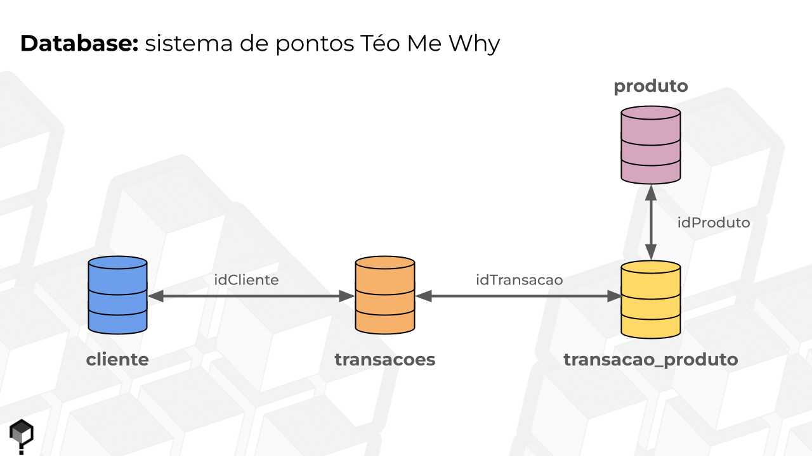
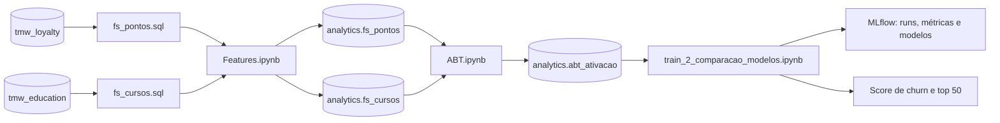

# Previsão de Churn na Comunidade TMW
### Case Prático em Python e Databricks (CPPD)

Projeto de Data Science de ponta a ponta desenvolvido no **Case Prático em Python e Databricks**, com dados reais da comunidade [Téo Me Why](https://teomewhy.org/twitch), uma iniciativa de educação gratuita em dados que faz lives na Twitch.

O projeto cobre todas as etapas de um pipeline de dados: entendimento do negócio, criação de features em SQL, montagem da ABT, modelagem com MLflow e uma proposta de ação de retenção.


---

## Problema de negócio

| Etapa | Objetivo |
|---|---|
| **Modelo** | Prever a probabilidade de churn de cada usuário nos próximos 28 dias |
| **Priorização** | Listar os 50 clientes com a maior probabilidade de churn |
| **Ação** | Propor uma ação de retenção para esses clientes |

---

## Dados

O projeto combina duas fontes da comunidade TMW:

**TMW Loyalty System** (`workspace.tmw_loyalty`) · [dataset no Kaggle](https://www.kaggle.com/datasets/teocalvo/teomewhy-loyalty-system/): o sistema de pontos da comunidade na Twitch. Os usuários acumulam pontos ao interagir nas lives: mensagens no chat, lista de presença (`!presente`), sequências de dias consecutivos (*streaks*) e resgate de pôneis.



| Tabela | Conteúdo |
|---|---|
| `transacoes` | Cada transação de pontos de um cliente (data, quantidade de pontos) |
| `transacao_produto` | Liga cada transação ao produto que a gerou |
| `produtos` | Tipos de interação (ChatMessage, Lista de presença, Presença Streak, Resgatar Ponei etc.) |

**TMW Education Platform** (`workspace.tmw_education`) · [dataset no Kaggle](https://www.kaggle.com/datasets/teocalvo/teomewhy-education-platform): a plataforma de cursos. Como o usuário pode conectar a conta da Twitch à plataforma, é possível relacionar o engajamento nas lives com o consumo de cursos.

| Tabela | Conteúdo |
|---|---|
| `usuarios_tmw` | Liga o usuário da plataforma ao cliente da Twitch |
| `cursos_episodios_completos` | Episódios concluídos por usuário |
| `cursos_episodios` | Catálogo de episódios de cada curso |

---

## Arquitetura do pipeline



1. **Feature store:** as consultas `fs_pontos.sql` e `fs_cursos.sql` recebem uma data de referência (`{date}`) e calculam as features de cada cliente usando só o que aconteceu **antes** dessa data. O `Features.ipynb` executa as consultas para cada safra mensal e grava em tabelas Delta, sobrescrevendo apenas a partição da `dtRef` (`replaceWhere`). Assim, cada safra pode ser reprocessada sem afetar as demais.
2. **ABT:** o `ABT.ipynb` junta as duas feature stores, calcula a variável resposta e monta a amostra de modelagem em `workspace.analytics.abt_ativacao`.
3. **Modelagem:** o notebook de treino segue o SEMMA, compara quatro algoritmos e registra tudo no MLflow.

---

## Variável resposta

- **Público:** clientes com pelo menos uma transação nos 28 dias anteriores à `dtRef`.
- **`flAtivacao = 1`:** o cliente volta a transacionar nos 28 dias a partir da `dtRef`.
- **Churn:** `flAtivacao = 0`. A probabilidade de churn é `1 − prob_ativacao`.
- **Safras:** mensais.

**Amostragem da ABT:**
- **Treino e teste:** safras até `2026-05-01`, com **uma safra sorteada por cliente**, para que nenhum cliente apareça mais de uma vez.
- **OOT (*out-of-time*):** todos os clientes da safra `2026-06-01`, usada para simular a aplicação do modelo num período futuro.

---

## Features

**Pontos (`fs_pontos`):** comportamento nos últimos 28 dias e ao longo da vida do cliente.

| Grupo | Exemplos |
|---|---|
| Frequência e recência | `qtFrequencia` (dias distintos com transação em 28 dias), `recencia`, `freqVida`, `diasPrimeiraTransacao` |
| Volume | `QtdeTransacoes`, `qtPontos`, `qtPontosPositivos`, `saldoDia` |
| Ranking | `zScore` (pontos do cliente padronizados em relação aos demais) |
| Mix de produtos | `pctTransacaoChatMessage`, `pctTransacaoListapresenca`, `pctTransacaoPresencaStreak`, `qtdeProdutoDistintos` |
| Streak | `flStreak`, `DiasUltimoStreak` |

**Cursos (`fs_cursos`):** `qtdCursosIniciados`, `qtdCursosFinalizados`, percentual de avanço em cada curso, tempo médio entre o primeiro e o último episódio (`avgTempoInicioUltimo`) e tempo médio para concluir um curso (`avgTempoInicioFim`).

---

## Modelagem (SEMMA)

| Etapa | O que foi feito |
|---|---|
| **Sample** | Split treino/teste 80/20 estratificado pelo target e base OOT separada |
| **Explore** | Nulos, médias por classe, variáveis quase constantes (21 de 51), IV/KS/AUC univariados e correlação de Spearman |
| **Modify** | Imputação (0 para cursos, máximo para tempos e streak), aprendida só no treino; seleção de 11 features por IV médio/forte e filtro de correlação (\|ρ\| ≥ 0,8) |
| **Model** | `GridSearchCV` com 5 folds estratificados e ROC AUC: Random Forest, XGBoost, CatBoost e LightGBM (114 combinações) |
| **Assess** | AUC em treino, teste e OOT; refit em treino + teste; feature importance; lift por faixa de score |

Todos os experimentos são rastreados no **MLflow**: parâmetros, métricas, gráficos e o modelo final de cada algoritmo.

**Features selecionadas (11):** `qtFrequencia`, `freqVida`, `saldoDia`, `QtdeTransacoes`, `recencia`, `qtdeProdutoDistintos`, `qtPontosPositivos`, `flStreak`, `diasPrimeiraTransacao`, `pctTransacaoListapresenca`, `pctTransacaoChatMessage`.

---

## Resultados

| Algoritmo | AUC treino | AUC teste | AUC OOT | AUC OOT (refit) | Gap treino − teste |
|---|---|---|---|---|---|
| **Random Forest** | 0,877 | 0,788 | **0,857** | **0,852** | 0,089 |
| LightGBM | 0,826 | 0,788 | 0,849 | 0,843 | **0,037** |
| XGBoost | 0,839 | 0,790 | 0,854 | 0,841 | 0,049 |
| CatBoost | 0,878 | **0,794** | 0,844 | 0,830 | 0,084 |

**Modelo escolhido: Random Forest**, pela maior AUC no OOT. As variáveis mais importantes são `qtFrequencia` (18,8%), `recencia` (16,7%) e `freqVida` (14,8%).

**Lift de churn na base OOT** (239 clientes, taxa média de churn de 43,9%):
- **77%** de churn nos 20% de maior risco, contra **0%** nos 20% de menor risco
- **69%** dos churns concentrados nos 40% de maior risco
- Lift de **1,8×** na faixa de maior risco, para um máximo possível de 2,3×

---

## Ação proposta: plano de retenção com pontos

**Público:** os 50 clientes com maior probabilidade de churn na safra mais recente.

| Mecânica | Como funciona | Atua em |
|---|---|---|
| Bônus de retorno | Pontos em dobro na primeira presença em live das próximas 4 semanas | Recência |
| Desafio de sequência | Bônus crescente a cada presença seguida em lives | Frequência e streak |
| Resgate facilitado | Recompensa exclusiva e de menor custo para quem tem saldo parado | Saldo de pontos |

**Medição:** metade dos 50 clientes, sorteada, forma o grupo de controle e não recebe a ação. A métrica é a taxa de churn em 28 dias, comparada entre tratados e controle e repetida a cada safra mensal.

---

## Estrutura do repositório

```
├── fs_pontos.sql                     # Features do sistema de pontos por dtRef
├── fs_cursos.sql                     # Features da plataforma de cursos por dtRef
├── Features.ipynb                    # Executa as queries por safra e grava as feature stores
├── ABT.ipynb                         # Cria a variável resposta e a ABT de modelagem
├── train_2_comparacao_modelos.ipynb  # SEMMA, comparação de modelos, MLflow, score e lift
└── img/                              # Imagens do README
```

## Como reproduzir

1. Baixe os datasets públicos do Kaggle:
   [TeoMeWhy Loyalty System](https://www.kaggle.com/datasets/teocalvo/teomewhy-loyalty-system/) e
   [TeoMeWhy Education Platform](https://www.kaggle.com/datasets/teocalvo/teomewhy-education-platform).
2. Carregue as tabelas no Databricks nos schemas `workspace.tmw_loyalty` e `workspace.tmw_education`,
   com os mesmos nomes usados nas queries (`transacoes`, `transacao_produto`, `produtos`,
   `usuarios_tmw`, `cursos_episodios_completos`, `cursos_episodios`).
3. No `Features.ipynb`, ajuste `feature_name` (`fs_pontos` ou `fs_cursos`) e o intervalo de datas, e execute para cada feature store.
4. Execute o `ABT.ipynb` para criar `workspace.analytics.abt_ativacao`.
5. Execute o `train_2_comparacao_modelos.ipynb`. Antes, ajuste o ID do experimento no MLflow para o seu workspace.

---

## Créditos

Projeto desenvolvido por **George Pagliuso** no curso **Case Prático em Python e Databricks**, ministrado por [Téo Me Why](https://teomewhy.org/twitch), com os dados da comunidade TMW.
